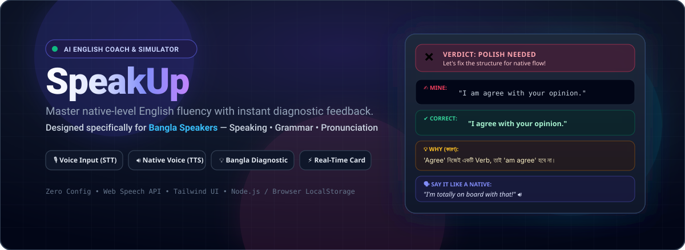

<p align="center">
  
</p>

<h1 align="center">SpeakUp — AI English Coach & Simulator</h1>

<p align="center">
  <strong>Master Native-Level English Fluency • Tailored for Bangla Speakers</strong>
  <br>
  Speak, listen, write, and eliminate common Bengali-English grammatical pitfalls with real-time diagnostic cards.
</p>

<p align="center">
  <a href="https://gitwithmasum.github.io/SpeakUp/"></a>
  <a href="#speaking--simulator"></a>
  <a href="#quick-start"></a>
  <a href="LICENSE"></a>
</p>

---

## 🌟 Overview

**SpeakUp** is an interactive, voice-enabled English speaking coach and diagnostic practice simulator built specifically for Bengali (Bangla) speakers. 

Instead of generic grammar lessons, SpeakUp analyzes how you express thoughts, catches common Bangla-to-English translation habits (*e.g., "I am agree", "gave exam", "discuss about"*), explains the root causes in clear **বাংলা**, and provides native-level idiomatic alternatives.

---

## ✨ Features

### 🎙️ Speaking & Live Simulator
- **Voice-to-Text (STT)**: Speak naturally into your microphone using the Web Speech API.
- **Native Voice (TTS)**: Listen to Ciri pronounce the corrected sentences, idioms, and tricky phonetic sounds.
- **Instant Diagnostic Card (After Every Sentence)**:
  - **Verdict**: ✅ Correct / ❌ Needs Polish
  - **Side-by-Side Comparison**: What you said vs. the natural native equivalent.
  - **💡 Why (বাংলায় ব্যাখ্যা)**: Clear 1-line reason for grammar, preposition, or tense errors.
  - **🗣️ Say it like a native**: Everyday casual/idiomatic alternatives.
  - **📚 Vocab Booster**: 2-3 power words/collocations from the conversation topic.
  - **🎯 Pronunciation Tip**: Phonetic breakdown for tricky words.

### 🇧🇩 Bangla Drills & Challenges
- 15+ curated translation drills categorized by **Workplace & Interviews**, **Daily Life**, and **Smart Idioms**.
- Try translating thoughts like *"আমি ট্রাফিকে আটকা পড়ে গিয়েছিলাম"* directly into native English with instant feedback.

### ⚠️ Top Bangla Pitfalls Reference
- Built-in reference solving the top 60+ frequent Bengali habits (*collocations, verb structures, prepositions, redundant words*).

### ✍️ Writing, Reading & Vocabulary Notebook
- **Writing**: AI-generated mini writing tasks with full feedback cards.
- **Reading**: Short passages, listen mode, comprehension quiz, and vocabulary building.
- **Notebook**: Spaced-repetition review of saved words.
- **Local Persistence**: Progress, streak, and notebook data are saved directly in browser `localStorage`. No database setup required!

---

## 🚀 Quick Start

### Option 1: Direct in Browser (No Server Needed)
Simply open [`index.html`](index.html) in any modern browser (Chrome, Edge, Brave):
```bash
# Windows
start index.html

# macOS
open index.html

# Linux
xdg-open index.html
```

### Option 2: Run via Node.js Server
Requires **Node.js 18+** (Zero external `npm install` dependencies needed):

```bash
# 1. Setup environment file
cp .env.example .env     # Add your LLM API Key inside

# 2. Start server
npm start
```
Then open [http://localhost:3000](http://localhost:3000) in Chrome or Edge.

---

## 📡 API Endpoints

| Route | Method | Payload / Purpose |
|---|---|---|
| `/api/feedback` | `POST` | `{text, context}` ➔ `{verdict, corrected, reason_en, reason_bn, native_alt, pronunciation_tip, vocab[]}` |
| `/api/chat` | `POST` | `{history, topic, level}` ➔ `{reply}` |
| `/api/task` | `POST` | `{type: "writing" \| "reading", level}` ➔ Returns a mini practice task |
| `/api/health` | `GET` | Health check & server status |

---

## 📂 Project Structure

```
SpeakUp/
├── assets/
│   ├── banner.svg          # Official GitHub README Banner
│   ├── logo.svg            # Official Vector Logo
│   ├── logo-option2.svg    # Alternate Branding Logo
│   └── banner-3d.jpg       # 3D Cyber Edition Banner
├── public/
│   ├── css/style.css       # Core styles
│   ├── js/app.js           # Client-side audio & chat logic
│   └── index.html          # Server-served UI
├── index.html              # Standalone Zero-Config Simulator
├── server.js               # Node.js backend server
├── package.json
├── .env.example
├── LICENSE
└── README.md
```

---

## 🌐 Deploy to GitHub Pages

To make SpeakUp accessible on the web for free:
1. Go to your repository settings on GitHub: [github.com/gitwithmasum/SpeakUp/settings/pages](https://github.com/gitwithmasum/SpeakUp/settings/pages).
2. Under **Build and deployment > Source**, choose **Deploy from a branch**.
3. Select branch **`main`** and folder **`/(root)`**, then click **Save**.
4. Your site will be live at: `https://gitwithmasum.github.io/SpeakUp/`

---

## 📄 License

Distributed under the **MIT License**. See [`LICENSE`](LICENSE) for more details.
